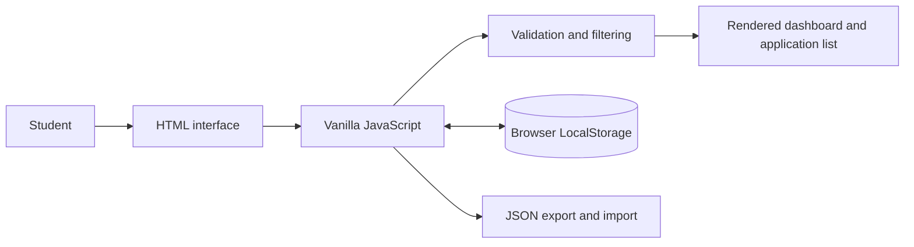
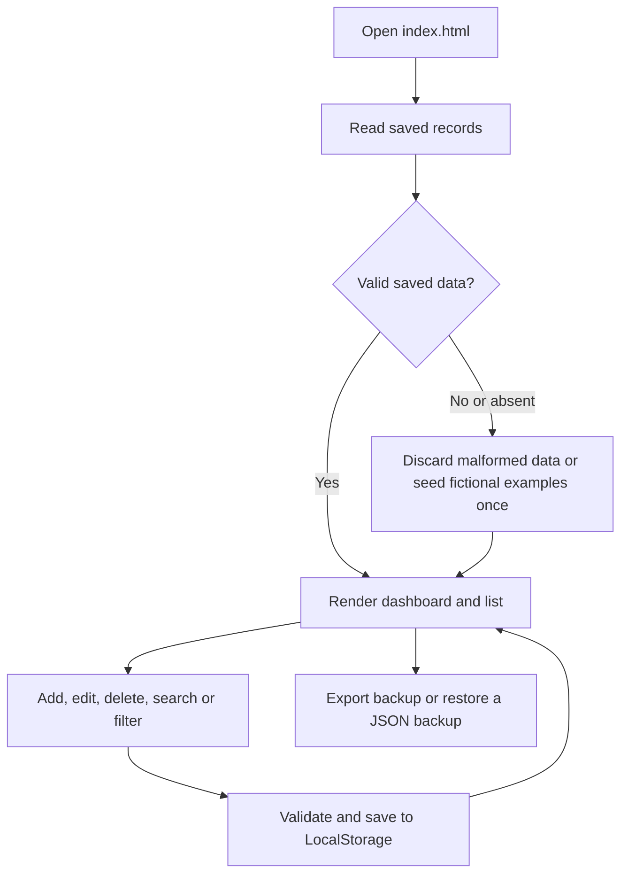

# Placement Preparation and Application Tracker

**AAT-1: Portfolio-Driven Activity · Full Stack Technologies**<br>
New Horizon College of Engineering, Bengaluru · Department of Computer Science and Engineering

**Student:** Naveen Kumar G. · **USN:** 1NH23CS164

## Introduction

Placement Tracker is a local-first dashboard for organizing campus placement and internship applications. It keeps company and role details, hiring stages, deadlines, package information and preparation notes together in one browser-based workspace.

The implementation follows the supplied AAT-1 project brief. The original report was not present in the workspace when this project was created, so its proposed architecture could not be inspected. This version is deliberately implemented with HTML, CSS, JavaScript and browser LocalStorage. It does not include the MongoDB and Express architecture mentioned in the brief's source-report context.

## Problem Statement

Students often track opportunities across messages, spreadsheets and personal notes. This makes it easy to miss an application deadline or lose track of a hiring stage. A small, searchable pipeline can make the next action for each opportunity easier to see.

## Objectives

- Keep placement and internship opportunities in one organized list.
- Track the current hiring stage and application deadline.
- Surface application counts and near-term deadlines from saved records.
- Keep preparation notes with each opportunity.
- Run without a backend, account, API key, package installation or internet connection.

## Features

- Four live summary values: total applications; applications in active stages (Applied, Online Test and Interview); offers received; and deadlines within the next seven days.
- Add, edit and confirmation-protected delete for application records.
- Required company, role and deadline fields; job type and hiring-stage selectors; optional package in LPA and notes up to 500 characters.
- Case-insensitive company/role search, status and job-type filters that combine, and deadline, company or recent-update sorting.
- Deadline labels for today, tomorrow and passed deadlines.
- Fictional sample opportunities marked **Demo**. Use **Clear demo records** to remove only those rows; the action asks for confirmation and does not affect personal records.
- JSON export and validated JSON restore. Restore replaces the current list after confirmation.
- Responsive desktop/mobile layout, semantic labels, keyboard focus styles, reduced-motion support and accessible status messages.
- LocalStorage is read defensively; malformed saved records are discarded, and storage write failures are surfaced to the user.

## Technology Stack

| Technology | Use |
| --- | --- |
| HTML5 | Semantic page structure and accessible forms |
| CSS3 | Responsive layout, status styling and reduced-motion behavior |
| Vanilla JavaScript (ES6) | Application state, validation, filtering and rendering |
| Browser LocalStorage | Persistent application records on this device/browser |

There are no runtime libraries, remote fonts, external APIs, build tools or package-install steps. The visual type stack uses local system fallbacks.

## System Architecture



Everything runs in the browser. There is no server-side database, Express API, authentication, cloud synchronization or deployment service. A static file server can be used for local preview, but it does not provide application data services.

## Application Workflow



## Data Model

Each application is stored as a JSON object with these fields:

| Field | Type | Description |
| --- | --- | --- |
| `id` | string | Unique record identifier |
| `company` | string | Company name; required |
| `role` | string | Job role; required |
| `jobType` | string | `Internship`, `Full-Time` or `Internship + PPO` |
| `deadline` | string | Local calendar date in `YYYY-MM-DD` format; required |
| `status` | string | `Wishlist`, `Applied`, `Online Test`, `Interview`, `Offered` or `Rejected` |
| `package` | string | Optional package amount, normalized with `LPA` |
| `notes` | string | Optional preparation notes, maximum 500 characters |
| `demo` | boolean | Marks fictional demonstration records |
| `updatedAt` | string | ISO timestamp used by recent-update sorting |

Records are held in the `aat1-placement-tracker-applications-v1` LocalStorage key. A separate `aat1-placement-tracker-demo-seeded-v1` flag prevents demonstration records from reappearing after the user clears them.

## Files and Folders

```text
placement-preparation-application-tracker/
├── index.html
├── style.css
├── script.js
├── README.md
├── .gitignore
└── screenshots/
    ├── dashboard.png
    ├── application-stages.png
    ├── add-application.png
    ├── edit-application.png
    ├── search-and-filters.png
    ├── empty-state.png
    └── mobile-dashboard.png
```

## LocalStorage Design and Limitations

LocalStorage keeps this project simple and works without an internet connection. Data belongs to the current browser profile and origin on the current device; it is not encrypted, synced, shared or backed up automatically. Clearing browser site data, changing browsers/devices, or opening the app under a different origin can make saved records unavailable. Browser storage quotas and private-browsing policies vary. Export JSON backups periodically and store them somewhere private; notes may contain personal information. This is a learning/demo application, not a secure production record system.

## Run Locally

1. Open `placement-preparation-application-tracker/index.html` in a modern browser. No installation or account is required, and the app has no internet dependency.
2. If the browser restricts LocalStorage on `file:` URLs, use an installed Python 3 static server from the workspace parent directory:

   ```powershell
   python -m http.server 8000 --directory .\placement-preparation-application-tracker
   ```

   Then open `http://localhost:8000/`. This is only a static file preview; the tracker itself still runs entirely in the browser.

## Using the Application

- **Add:** Select **Add application**, fill in company, role and deadline, choose job type/status, and save. Package is numeric LPA; notes are limited to 500 characters.
- **Edit:** Select the pencil control on an application, update its fields and save changes.
- **Delete:** Select the delete control and confirm. The prompt names the company and warns that deletion cannot be undone.
- **Search and filter:** Search company or role, then optionally select a status and job type. Filters apply together. **Clear filters** resets search, filters and sorting.
- **Sort:** Choose soonest/latest deadline, company A–Z or recently updated.
- **Understand deadlines:** Active records due today, tomorrow or within seven days get an explicit label; past deadlines are labeled separately. Offered and rejected records do not count toward the upcoming-deadline summary.
- **Back up:** Choose **Export** to download a JSON file. **Import** validates a JSON backup and asks before replacing the current list. The import file must contain either an array of valid application records or the exported object with an `applications` array.
- **Remove examples:** Choose **Clear demo records** and confirm. Only rows marked `Demo` are removed; personal rows remain.

## Testing Performed

Browser checks were performed against a local static server using the integrated browser on 19 October 2026.

| Check | Result |
| --- | --- |
| App opens and renders five fictional demo records | Passed; summary showed 5 total, 3 in progress, 1 offer and 3 upcoming deadlines |
| Create and edit an application | Passed; saved a test record, changed its role/status and observed summary update from 3 to 4 in progress |
| Form validation | Passed; a negative package was rejected and the dialog remained open; required company/role/deadline fields are validated in code |
| Search and combined status/type filters | Passed; matching Pixel & Pine with Applied + Internship + PPO returned one record; a mismatching type returned none |
| Deadline sorting | Passed; latest-first order placed the furthest deadline ahead of nearer and passed dates |
| Persistence after refresh | Passed; the edited test application remained after reload |
| Delete confirmation and empty state | Passed; deleting the imported test row resulted in zero summary counts and the empty state |
| Demo-record clearing | Passed; confirmation-protected clear removed all five demo rows, then demo data was restored for delivery |
| JSON export | Passed; inspected the generated download blob and verified a dated filename and six serialized applications during the test |
| JSON import | Passed; imported a valid one-record backup after confirmation and saw the restored record and updated count |
| Mobile and desktop layout | Passed at 390px and 1440px viewport widths; document width did not exceed viewport width |
| External network dependencies | Passed; the dashboard made no external resource requests |
| Editor diagnostics and JavaScript syntax | Passed; no file diagnostics and `node --check` completed without errors |

These are browser checks of the listed flows, not a formal accessibility audit or a cross-browser test matrix.

## Screenshots

All images below were captured from the running application in the integrated browser. The examples shown are fictional.

- Dashboard and summary cards: [screenshots/dashboard.png](screenshots/dashboard.png)
- Application list with hiring stages: [screenshots/application-stages.png](screenshots/application-stages.png)
- Add application dialog: [screenshots/add-application.png](screenshots/add-application.png)
- Edit application workflow: [screenshots/edit-application.png](screenshots/edit-application.png)
- Search and combined filters: [screenshots/search-and-filters.png](screenshots/search-and-filters.png)
- Empty state after deleting the last record: [screenshots/empty-state.png](screenshots/empty-state.png)
- Mobile dashboard: [screenshots/mobile-dashboard.png](screenshots/mobile-dashboard.png)

## Known Limitations

- Data stays in one browser profile and is not encrypted, synchronized or shared.
- There is no server, user account, role-based access or cross-device collaboration.
- Backup and restore are manual; a restore replaces the current list.
- Package values are a numeric LPA amount, so monthly stipend formats are not represented separately.
- The application uses browser-native date and storage behavior; browser support varies.
- The original AAT-1 report was not found among the supplied workspace files, so this implementation used the project title and requirements in the user-provided brief.

## Future Enhancements

- Add CSV export and calendar reminders.
- Add richer application-stage history and interview schedules.
- Add a separate stipend field and currency support.
- Add an optional, consent-based encrypted backup workflow while retaining offline-first use.
- Add a formal accessibility review and tests across additional browsers.

## Author

**Naveen Kumar G.**<br>
USN: **1NH23CS164**<br>
Department of Computer Science and Engineering<br>
New Horizon College of Engineering, Bengaluru<br>

